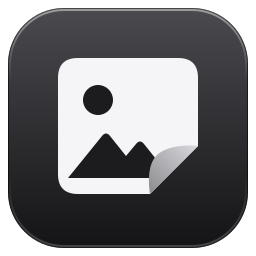

<picture>
  <source media="(prefers-color-scheme: dark)" srcset="packaging/fotodit-logo-light.svg">
  
</picture>

# Fotodit

A simple Windows app that removes **all hidden information** from photos and videos (location, camera, date,
serial number, author, editing history, embedded thumbnails, GPS tracks …), converts photos **flawlessly to
JPG** and videos **to MP4**, **rotates, flips and crops** them, adjusts their **exposure** (RAW photos from
their RAW data), **shrinks** photos for sharing, **trims** videos and **removes parts** or the **sound** from
them, **plays** them, finds **duplicates** in a selection, and in bulk **sorts and renames** files (photos and
videos separately, by number or by capture date) or **groups them into folders**. Its interface follows
Apple's Liquid Glass design as iOS 27 draws it, in black, white and greys (color only for warnings and
errors), in a light and a dark look, in Turkish or English. It works entirely offline.

Fotodit is free and open source software under the **GNU General Public License, version 3 or later**
(see [LICENSE](LICENSE)); the components it is built on and their licenses are listed in
[THIRD-PARTY-NOTICES.md](THIRD-PARTY-NOTICES.md). Copyright © 2026 Artapa.

The user interface is in Turkish and English. It follows Windows' display language at first (Turkish on a
Turkish Windows, English otherwise), and **Görünüm → Dil** (Appearance → Language) switches it. This README
gives each on-screen label in Turkish, in bold, followed by an English gloss the first time it appears.

Details of the research and the design decisions: [docs/RESEARCH.md](docs/RESEARCH.md)

## Running

Download one of the release zips and unpack it; no installation is needed:

* `Fotodit-<version>-windows-x64.zip` (recommended): double-click `Fotodit\Fotodit.exe`. You can move the
  `Fotodit` folder anywhere you like (together with the `_internal` folder inside it).
* `Fotodit-<version>-windows-x64-portable.zip`: a single `Fotodit.exe` (about 100 MB). It is easier to
  copy, but it starts a few seconds later because it unpacks itself into a temporary folder every time.

`SHA256SUMS.txt` next to the zips lets you check a download (`certutil -hashfile <zip> SHA256`). As long as
the exe is not signed (see [Signing](#signing)), Windows SmartScreen may say "Windows protected your PC" the
first time: **More info → Run anyway**. Windows 10 and 11 (64-bit) are supported.

Built from source (see [For developers](#for-developers)), the same programs are in `dist\Fotodit\` and
`dist\onefile\`.

> Tip: if you put a shortcut to `Fotodit.exe` into the `shell:sendto` folder, you can select photos in File
> Explorer and add them straight to the selection with right-click → **Send to → Fotodit**.

## Usage

1. **Select photos and videos on the Gözat (Browse) tab.** Open folders in the tree on the left (a click
   on a name opens it) or **double-click** a folder tile; a single click on a folder tile only highlights
   it, so a click meant for a photo never takes you into another folder. Clicking a file selects it,
   clicking it again deselects it. Video tiles show a **▶ duration** label. **Shift+click** selects a
   range. Your selection is kept when you move to other folders.
   * **The path bar** at the top shows where you are as steps (e.g. `Resimler › 2024 › Tatil`); click a
     step to go up to it. Click the bar's empty part (or press **Ctrl+L**) to type or paste a path: **Enter**
     opens it, **Esc** goes back. A path that does not exist stays in the bar to be corrected.
   * **Selecting a folder without opening it:** click the **circle** on the folder's icon (or Ctrl+click
     the tile), or tick the folder's **box** in the tree on the left. All photos and videos in the
     folder, **subfolders included**, are scanned in the background and selected. Each folder tile shows how
     many photos and videos the folder holds (e.g. `124 fotoğraf, 6 video`: 124 photos, 6 videos); the
     circle/box shows whether the folder is fully (✓) or partly (–) selected. Clicking again deselects it.
   * **Tümünü Seç** (select all, Ctrl+A) selects the photos and videos in the open folder and its subfolders
     (with everything in them).
   * You can drag and drop files/folders onto the window, or use the Windows file dialog through
     **Dosya Ekle…** (add files…).
   * Very large selections (more than 10,000 photos) ask for confirmation once; the scan can be interrupted
     with **Durdur** (stop) in the capsule that appears at the bottom of the window.
2. **Check them on the Seçilenler (Selected) tab.** The photos and videos you selected from different folders
   are gathered here, and the **new name and location** each one will get is shown live. Clicking a file lists
   the hidden information it contains (GPS location, camera, date …) at the bottom left.
   * **Kopyaları Bul** (find duplicates) looks for files that are the same: byte-for-byte copies, and the same
     picture saved with different hidden information (for example a cleaned copy next to its original). The
     copies (every file of a group but the first) are marked in the **Bilgi** (info) column and highlighted,
     so **Listeden Çıkar** (remove from the list) takes them out of the selection. Nothing is deleted.
   * When **Gizli Bilgileri Sil** is on and renaming is off, a line at the bottom says how many file names
     still give away a date or a device (`IMG_20240512_143022`, `PXL_…`, `WhatsApp Image …`); the hidden
     information goes, but the name stays.
   * **Large preview:** the **Büyük Önizleme** (large preview) button, a double-click on a row or **Space**
     shows the selected files in a full window. Navigate with **← →** (or the side arrows, the mouse wheel,
     the thumbnail strip at the bottom); **Del** removes the file from the selection, and pressing **Del**
     again puts it back in its place. **Double-click / Z** shows the actual size (100%, drag with the mouse),
     **I** the metadata panel, **F11** full screen, and **Esc** closes. The line under the title shows the
     size, format, date, camera, a GPS warning and the name after processing. Holding **O** (or the compare
     button) shows the photo without its edits.
   * **Double-clicking** a photo in Gözat (without changing the selection) opens that folder's photos in the
     same preview; **Del** selects/deselects there as well.
   * The preview shows photos the right way up and in sRGB colors, just like the JPG conversion (iPhone
     Display P3, Adobe RGB and CMYK are corrected); for RAW files the camera's embedded preview is used.
   * **Rotate, flip and crop (in the preview):** **R** / **L** (or the ↻ ↺ buttons) rotate by 90°, **H**
     (**Yatay çevir**, flip horizontally) mirrors the photo left to right, for example a selfie with reversed
     text. **C** or **Kırp ve Düzelt** (crop & straighten) opens crop mode: drag the corners/edges of the box,
     or grab it inside to move it; pick **Serbest** (free), **Orijinal oran** (original), **Kare** (square),
     4:3, 3:2, 16:9 … from the **Oran** (aspect ratio) list; align a tilted horizon with the grid using the
     **Eğiklik** (tilt) slider (±45°; the box shrinks automatically so that no empty corners appear).
     **Enter** (or a double-click inside the box) applies, **Esc** cancels, **Ctrl+Z** undoes the last edit,
     and **Kaldır** (remove), next to the description of the edits, deletes all of the file's edits.
   * **Exposure (in the preview):** under a photo there is a **Pozlama** (exposure) slider from −3 to +3 EV:
     to the right brightens, to the left darkens, **Sıfırla** (reset) goes back to 0. The preview shows the
     result live. A RAW with an exposure set is developed from its RAW data (the camera's embedded JPEG
     cannot win back detail in the highlights and shadows); brightening rolls the highlights off softly
     instead of clipping them. The exposure is applied when the RAW is converted to JPG. Other photos (JPG,
     HEIC, PNG, WebP, TIFF …) are adjusted the same way, in linear light; areas that are pure white or pure
     black in the file stay so (only a RAW still has that detail).
   * On Seçilenler you can mark several rows and rotate them all at once with **↺ / ↻** (Ctrl+L / Ctrl+R) or
     flip them (Ctrl+H); on Gözat you can edit photos one at a time with right-click → **Sağa döndür** /
     **Sola döndür** (rotate right/left), **Yatay çevir** or **Kırp ve düzelt…**. Edited photos show their
     thumbnails in the edited state with an **✎ düzenlendi** (edited) mark; if they were not selected, they
     are added to the selection.
   * **Videos play in the preview:** first a frame from the beginning of the video is shown; **click, K or
     Enter** plays/pauses. The bar at the bottom has seeking (**Shift+← →** 5 s), the time and the volume
     (**M** mutes, **↑ ↓** adjust the level); a double-click switches to full screen. Rotating and
     **cropping/straightening work on videos too**, with the same tools, and are visible during playback
     (the video pauses in crop mode). Portrait phone videos are shown the right way up. The **Bilgi** (info)
     column on Seçilenler shows the video's duration, resolution and codec (e.g. `🎞 0:42 · 4K HEVC HDR`) and
     what will be done (`MOV→MP4`, or `H.264'e kodlanacak`: will be encoded to H.264). Videos Qt cannot play
     (e.g. **AV1**, which Qt only decodes on the GPU) and files Qt cannot open are played by Fotodit's own
     **backup player** (PyAV): seeking, sound and editing work just the same.
   * **Trimming videos:** pause (or seek) where the video should start and click **Buradan Başlasın** (start
     from here), where it should end and click **Burada Bitsin** (end here); the parts that are kept are drawn
     on the seek bar, and **Kesmeyi Kaldır** (remove the trim) keeps the whole video. Trimming does not
     re-encode the video: playback starts at exactly the chosen frame and audio and subtitles are cut to the
     same part. Because a copied video can only start at a keyframe, the frames from the keyframe before the
     start (usually a second or two) **stay in the file, hidden** by the MP4 edit list (as with FFmpeg); the
     result says how much. A video that is re-encoded anyway (cropped, converted) is cut frame-exactly, with
     nothing hidden. Trimming works for MP4/MOV/3GP; other formats can be trimmed while being converted to MP4.
   * **Removing the sound:** **Sesi Kaldır** (remove the sound) in the video bar leaves the audio out of the
     output (it shows **Ses Kaldırılacak**: the sound will be removed). The picture is not re-encoded for
     this, and it works in every video format.
   * **Removing parts of a video:** click **Bölüm Çıkar** (cut out a part) where the part starts and again
     (**Bölüm Burada Bitsin**, the part ends here) where it ends; the part is marked red on the seek bar while
     you mark it, and **Esc** cancels. You can remove several parts, also at the very start or end. The video
     (and its audio) is re-encoded for this, so **nothing of the removed parts stays in the file**; the
     remaining parts are joined, and subtitles and chapters follow. Use this instead of trimming when the
     cut-away part must really be gone.
   * Edits are **not written to the file right away**; they are applied (together with the other options)
     when processing starts. Even if you choose no other operation, edited files are saved with their
     edits. If you close Fotodit while there are unapplied edits, it asks first.
   * **Görünüm** (appearance), at the bottom of the left panel: **Windows ayarına uy** (follow the Windows
     setting; the default), **Açık** (light) or **Koyu** (dark); the window frames turn dark too. As in iOS,
     **Cam: Daha şeffaf / Varsayılan / Daha buzlu** (glass: clearer / default / frostier) sets how much of
     what lies behind the glass surfaces shows through, and **Saydamlığı azalt** (reduce transparency) makes
     them solid. **Dil** (language): **Windows ayarına uy** (follow Windows; the default), **Türkçe** or
     **English**; the texts change when Fotodit starts again, which it offers to do at once (**Yeniden
     Başlat**, restart). The choices are remembered.
   * **Fotodit 1.3.0**, next to it (or **F1**), opens **Hakkında** (about): the version, the license, and the
     components Fotodit is built on with their license texts.
3. **Turn on the operations (right panel).** An operation's settings appear while it is on; hovering over a
   setting or its explanation shows more detail.
   * **Gizli Bilgileri Sil** (remove hidden information) — in videos this also removes location/sensor tracks
     (GoPro, DJI, Sony), iPhone's timed metadata tracks and the date/GPS record that camcorders embed in the
     video stream; the video is not re-encoded. **Subtitles are kept** (only the language information stays);
     tracks that store a location/camera log as subtitles, like those of DJI drones and dashcams, are
     recognized by their lines and removed.
     * ☐ **Çekim tarihini koru** (keep the capture date; off by default): everything is still removed except
       the date and time the photo or video was taken. A photo keeps one EXIF field (DateTimeOriginal: no
       time zone, no fractions of a second), an MP4/MOV/3GP video keeps it in its header, and the file's own
       date is set to it too, so Google Photos, iCloud and other galleries keep the files in order. GIF and
       BMP cannot hold EXIF, and other video formats no date in the file: they keep it only as the file date.
       Files without a capture date get none.
     * ☐ **Geniş renk alanını koru** (keep the wide color space): by default the
       colors of iPhone (Display P3) and professional camera (Adobe RGB, ProPhoto RGB) photos are converted
       to sRGB, which every device shows correctly. With this option they keep their vivid colors: the
       pixels stay as they are and the camera's color profile (which can name the device) is replaced with
       a clean, standard one. A JPG stays losslessly untouched. Profiles that are not one of these standards
       are still converted to sRGB.
   * **Fotoğrafları JPG'ye Dönüştür** (convert photos to JPG; quality selectable, 95% by default). If the
     selection contains RAW files, a **RAW** option appears: **Kamera görünümü** (camera look: the camera's
     embedded full-size JPEG, without recompression; developed from the RAW data if there is none) or
     **RAW verisinden işle** (develop from the RAW data: full resolution with LibRaw, camera white balance,
     sRGB).
   * **Fotoğrafları Küçült** (shrink photos): for sharing, the long edge becomes at most the chosen size
     (**Uzun kenar**, long edge: 1080 to 3840 pixels; 2048 recommended). Smaller photos are left as they are
     (never enlarged); a shrunk photo is re-encoded, a JPG with its own compression tables. A RAW can only be
     shrunk while it is converted to JPG.
   * **Videoları MP4'e Dönüştür** (convert videos to MP4): MOV, MTS/M2TS, AVI, MKV, WebM, WMV, 3GP, MPG …
     become MP4. **En uyumlu: H.264** (most compatible; the default) turns every video into H.264 + AAC,
     which opens on every device: videos that are already H.264 are copied without quality loss, the others
     (iPhone HEVC, MJPEG, WMV, MPEG-2 …) are re-encoded (visually indistinguishable, but it takes time);
     iPhone HDR videos are converted to SDR with their colors preserved. **Hızlı ve kayıpsız: kodek korunur**
     (fast and lossless: codec kept) moves the video into MP4 with as little re-encoding as possible (HEVC
     stays HEVC; some older devices may not open it). SRT, ASS and WebVTT subtitles from MKV/WebM are
     converted to MP4's subtitle format (italics/bold are kept).
   * ☐ **Ekran kartıyla kodla** (encode with the GPU): videos that get re-encoded (HEVC → H.264, cropping …)
     use the GPU's hardware encoder: NVIDIA NVENC, Intel Quick Sync, AMD AMF or Windows Media Foundation
     (whichever works; found with a small test encode, once per session). On this computer 1080p HEVC → H.264
     became 2.3 times faster and 4K HDR 1.7 times faster. If the encoder cannot be opened, fails, or produces
     a corrupt picture (the first frame is compared with the source), the video is automatically encoded on
     the CPU. If the GPU has a 10-bit HEVC encoder, cropped HDR videos stay HDR while **Hızlı ve kayıpsız**
     is selected.
   * **Sırala ve Yeniden Adlandır** (sort & rename): **Ad biçimi** (name format) chooses between **Önek ve
     numara** (prefix and number: `Tatil_1`), **Çekim tarihi ve saati** (capture date and time:
     `2024-05-12_14-30-22`; files from the same second get `_2`, `_3` …) and **Çekim günü ve numara** (capture
     day and number: `2024-05-12_001`, counting from 1 every day). With the date formats, files without a
     capture date become `Tarihsiz_1` … (`Undated_1` in English). A date in the name stays even though the
     hidden information is removed; the confirmation says so. Files are sorted by capture date, file name (the
     order in the folder), modification time, size or an order you set by hand, and the number format numbers
     them `1, 2, 3 …` (optional prefix, start number, 01/001 padding). The capture date is read from the
     photo's/video's own metadata, or else from the file name (`IMG_20240512_…`). When sorting by capture
     date, **files without a capture date come last, in the order you selected them** (in folder order if you
     selected a folder); they are not slotted in between by the file's modification time. Files with the same
     date (or the same size) also keep the order you selected them in; Seçilenler shows how many files have no
     capture date. To change this order, choose **Seçtiğim sıraya göre** (in the order I chose) and drag the
     rows. **Photos and videos are named separately:** each has its own prefix and first number, and they are
     numbered independently (`Holiday_1.jpg, Holiday_2.jpg …` and `Video_1.mp4, Video_2.mp4 …`). Numbering
     restarts in every target folder: if you select a parent folder and use **Orijinal dosyalara uygula**
     (apply to originals), each subfolder is numbered `1, 2, 3 …` on its own (the same result as processing
     the folders one by one).
   * **Klasörlere Ayır** (group into folders): by month (`2024-05 Mayıs`), year or day, or **Kaynak klasör
     yapısını koru** (keep the source folder structure: the folders you selected are recreated with their
     names and subfolders, e.g. `Archive\2019\Holiday\1.jpg`; numbering starts at 1 in every folder). When
     grouping by month, year or day, files without a capture date go into a folder named **Tarihsiz**
     (undated); with the capture-date sort they are numbered there in selection order. The month names and
     the undated folder follow the interface language (`2024-05 May`, `Undated` in English).
4. **Choose where to save.**
   * **Yeni klasöre kaydet** (save to a new folder; recommended): the originals never change; files selected
     from different folders are gathered into one folder (to keep the folder structure, use the option
     above; the panel also suggests it).
   * **Orijinal dosyalara uygula** (apply to originals): files are changed in their own folders (so the
     folder structure is kept anyway); the originals are moved to the **Recycle Bin** (so this can be
     undone). For large jobs the confirmation dialog checks the free space and the Recycle Bin's capacity,
     and warns if the capacity would be exceeded (Windows may then delete old items permanently).
5. Press the **N Fotoğrafı ve M Videoyu İşle** (process N photos and M videos) button and confirm the
   summary. The result lists the files that succeeded or failed, plus notes you should know about
   (e.g. "renkler sRGB'ye dönüştürüldü": colors converted to sRGB).

## What does it guarantee?

* **JPGs are not recompressed:** metadata is removed at the byte level and the image data stays exactly as
  it was (the same goes for PNG, WebP, GIF and BMP).
* **Photos do not end up sideways:** the "rotate" flag that phones write is applied to the pixels before it
  is removed (without visible quality loss, using the source's own compression tables).
* **Colors do not fade:** profiles such as iPhone Display P3, Adobe RGB and CMYK are converted to sRGB before
  they are removed (or, with **Geniş renk alanını koru**, wide color spaces are kept with a clean standard
  profile).
* **Rotating/cropping does not reduce quality:** JPGs are re-encoded with the source's own compression
  tables; the crop box is aligned to the JPEG's 16-pixel block grid (the box moves by at most 15 pixels), so
  the blocks line up with those of the source (measured difference on a 12 MP photo ~50 dB: invisible to the
  eye). For PNG, lossless WebP, TIFF and BMP, editing is completely lossless. Straightening requires
  resampling (bicubic). If metadata stripping is off, the metadata is kept; only the orientation is
  corrected, and thumbnails of the old image (they could show the cropped-away area) are removed. RAW files
  can only be edited (rotated, cropped, exposure) while being converted to JPG.
* **The RAW exposure is done on the RAW data:** at 0 EV the development matches LibRaw's own exactly (the
  same automatic brightening and sRGB curve); the preview and the thumbnails use the same calculation. Other
  photos get the same curve on their pixels, in linear light.
* **Every output is verified:** it is scanned again, all of its bytes are searched for metadata signatures,
  and it is decoded from start to end; if anything is wrong, the file is left untouched. With **Çekim tarihini
  koru**, the output must hold exactly the one date and nothing else.
* **Shrinking never enlarges:** photos already within the limit take their usual path (a JPG stays
  untouched); a shrunk photo is resampled with Lanczos after its orientation and colors are fixed.
* **Stripping metadata from videos does not change the picture:** only the video, audio and subtitle tracks
  are written to a new file, with their packets copied as is (the frames are identical, and it runs at disk
  speed). The file's tags, the dates in the file header, location/sensor tracks, location/camera logs written
  as subtitles, cover art, chapters and user data embedded in the video stream (AVCHD's date/GPS record, the
  encoder line) do not survive; the portrait orientation flag is kept. **90° rotation** and **trimming** are
  lossless in MP4/MOV (only the orientation flag / the edit list change; a trim keeps the frames since the
  keyframe before its start hidden in the file, see above); cropping, straightening and removing parts
  require re-encoding (H.264, CRF 18). Formats that cannot carry an orientation flag or an edit list, such as
  AVI/MKV/MTS, can only be edited while being converted to MP4.
* **No file is ever overwritten**; if you cancel, nothing changes; broken files are skipped and reported.

| Format | Metadata stripping | Conversion to JPG |
|---|---|---|
| JPG / JPEG / JFIF | Lossless (visually lossless re-encoding if the orientation/color profile requires it) | Already JPEG (only `.jpeg/.jfif` → `.jpg`) |
| PNG, WebP, GIF, BMP | Lossless | ✓ |
| HEIC / HEIF, AVIF | Re-encoded (quality 90%) — converting to JPG is recommended | ✓ |
| TIFF | Rewritten with lossless compression | ✓ |
| RAW: DNG, CR2, CR3, NEF, ARW, RAF, ORF, RW2, PEF, SRW … | Only by converting to JPG (a RAW file cannot be cleaned in place) | ✓ |

| Video | Metadata stripping | Conversion to MP4 (most compatible) |
|---|---|---|
| MP4, MOV (iPhone), 3GP | Lossless | H.264 is copied; HEVC/AV1/VP9 → H.264 (HDR → SDR) |
| MTS / M2TS (AVCHD camcorders) | Lossless (the date/GPS record in the video stream is removed too) | H.264 is copied, AC-3 audio → AAC |
| AVI (MJPEG, DivX), WMV, MPG/VOB, FLV | Lossless (including the EXIF in MJPEG frames) | Encoded to H.264 |
| MKV, WebM | Lossless | H.264 is copied; VP9/AV1 → H.264, Opus/FLAC → AAC, SRT/ASS → MP4 subtitles |

> The Lightroom/Capture One **.xmp sidecar files** next to RAW files are separate files and are not
> processed; delete them yourself before sharing.

### Large archives

Folder selection stays smooth even with tens of thousands of photos (measured on this computer): selecting a
folder with 20,000 photos in 310 folders takes ~0.4 s, and **Tümünü Seç** in a folder with 3,000 subfolders
takes ~4.6 s; the UI does not freeze in the meantime. Folder scans skip hidden/system folders, names
starting with "." such as `.thumbnails` / `.trashed`, macOS `._` files and folder links (junctions). Unless
sorting or grouping by date is selected, processing can start before the photo information has been read.

## Where is data kept?

Settings and log: `%LOCALAPPDATA%\Fotodit\` (`settings.ini`, which version 1.3.0 and earlier called `ayarlar.ini`
and which is renamed at the first start; `fotodit.log`, into which no file names or paths are written). The `FOTODIT_DATA_DIR` environment variable selects another folder (e.g. for portable use from a
USB stick). The app does not connect to the internet.

## For developers

Requirements: Windows 10/11 (64-bit) and Python 3.14 (`py -3.14`). `packaging\build.ps1` creates the virtual
environment and installs the pinned dependencies (`requirements.txt`, `requirements-dev.txt`) from PyPI.

```powershell
# Environment, tests and exe (one command)
powershell -ExecutionPolicy Bypass -File packaging\build.ps1            # folder distribution: dist\Fotodit\Fotodit.exe
powershell -ExecutionPolicy Bypass -File packaging\build.ps1 -OneFile   # single file: dist\onefile\Fotodit.exe
powershell -ExecutionPolicy Bypass -File packaging\build.ps1 -Release   # both, self-tested, then the release zips

# Running from source, and tests
.venv\Scripts\python.exe -m fotodit
.venv\Scripts\python.exe -m pytest tests -q
.venv\Scripts\python.exe tests\ui\smoke_run.py <work-folder> [--visible] [--dark] [--en]  # UI smoke test + screenshots
dist\Fotodit\Fotodit.exe --self-test report.txt                 # self-test of the packaged app
```

Code, comments, tests and documentation are in English. The user interface is in Turkish and English:
every text it shows is in `fotodit/i18n/tr.json` and `en.json` and reaches the screen through `t()`, and the
tests check that both dictionaries hold the same texts and that no text is written straight in the code.
Lint: `.venv\Scripts\python.exe -m ruff check --select F,E9,W6,I,B --ignore B008,B007,B905 fotodit tests packaging`.

### Making a release

`packaging\build.ps1 -Release` builds both versions, runs the self-test of each, and packs `dist\release`
(`packaging\package_release.py`):

* `Fotodit-<version>-windows-x64.zip` and `Fotodit-<version>-windows-x64-portable.zip`, each with
  `LICENSE.txt`, `THIRD-PARTY-NOTICES.txt` and the `licenses` folder next to `Fotodit.exe`;
* `Fotodit-<version>-source.zip`, the source code (what the GPL calls the Corresponding Source of Fotodit);
* `SHA256SUMS.txt`.

The packing stops if a license text that `THIRD-PARTY-NOTICES.md` names is missing from the build. The
license files are collected by `packaging\fotodit.spec` (the texts in `licenses/` plus the ones the bundled Python
packages ship) and are also inside the exe, where the About window shows them. When you upgrade a
dependency, update its version and license in `THIRD-PARTY-NOTICES.md`.

The release contains GPL-licensed libraries (x264 and x265, inside FFmpeg), so it has to be offered
together with their source. `THIRD-PARTY-NOTICES.md` says where each component's source is; attaching
copies of those source archives to each release is the safest way to keep them available.

### Signing

Without a code-signing certificate, Windows SmartScreen warns about a newly downloaded exe until it has
earned a reputation. Two ways to sign:

* **SignPath Foundation** signs open source projects for free, from a CI build of the public repository
  (e.g. GitHub Actions); see https://signpath.org.
* **A certificate of your own** from a certificate authority (an OV or EV code-signing certificate):
  install it in your user certificate store (or on its hardware token), set `FOTODIT_SIGN_THUMBPRINT` to
  its thumbprint and add `-Sign` to the build (`packaging\build.ps1 -Release -Sign`). It needs `signtool.exe` from
  the Windows SDK; the signature is timestamped (`FOTODIT_SIGN_TIMESTAMP` chooses the RFC 3161 server,
  DigiCert's by default). The signed exe is self-tested again. (This path has not been tried with a real
  certificate yet.)

### Project structure

```
fotodit/
  core/             everything that works without Qt (a test checks that it never imports it)
    formats.py      format detection (from the first bytes)
    duplicates.py   finding duplicates: identical files and the same picture with other metadata
    folderscan.py   scanning folders with their subfolders (same skip rules as Gözat)
    meta/           format-specific parsers: jpeg, png, webp, gif, tiff, bmp, bmff (HEIC/AVIF), raw, exif, xmp
    colors.py       ICC analysis, sRGB conversion, recognizing standard wide color spaces;
                    iccgen.py  profile generation (nclx, Adobe RGB, Display P3, ProPhoto)
    imaging.py      safe opening, "clean" image object, mode conversions
    processor.py    one file: metadata stripping, JPG conversion, applying the edits, verification
    edits.py        edit model: 90° rotation, straightening, cropping (geometry and applying it to pixels),
                    exposure, video trim and removed parts
    rawdev.py       RAW → image (LibRaw/rawpy; camera JPEG or developing the RAW data, exposure)
    preview.py      image preparation for the large preview (orientation, sRGB, fast decoding at screen size)
    photoinfo.py    reading date/camera/GPS, date from the file name
    planner.py      sorting, naming, grouping into folders, name conflicts
    runner.py       applying to disk: temporary files, Recycle Bin, two-phase renaming
    errors.py       library errors turned into readable messages
    legal.py        where the license files are (bundle or source)
    dngwriter.py, tiffwriter.py  synthetic DNG/TIFF files for the self-test and the tests
    video/          videos (PyAV/FFmpeg): probe.py info (date, device, location, orientation), process.py
                    metadata stripping / MP4 conversion / rotate-crop / trimming / removing parts and
                    verification, bitstream.py data embedded in the video stream (SEI, MDPM, MJPEG),
                    boxes.py MP4/MOV boxes (also shortens the edit lists of a trimmed copy), tonemap.py
                    HDR → SDR, thumb.py thumbnail frame, subtitles.py subtitles (recognizing log tracks,
                    converting to MP4), hwenc.py GPU encoder (test encode, falling back to the CPU)
  i18n/             the texts in Turkish (tr.json) and English (en.json), t() with plurals, and numbers,
                    sizes and dates written each language's way
  ui/               PySide6 UI. The Liquid Glass design (iOS 27): glass.py the material (backdrop,
                    two-path frost, refraction, edge light and contour, shadow; three looks), controls.py
                    glass buttons, segmented control, switches, sliders, toast, icons.py the icons
                    (Hugeicons' data drawn as vectors, moving on hover), motion.py springs, theme.py light
                    and dark colors (black, white and greys), fonts.py the bundled Inter typeface, chrome.py
                    the floating toolbars and their backing, sheet.py dialogs as glass sheets. The screens:
                    main_window.py, browser.py (Gözat), selected_page.py (Seçilenler), nav.py (folders),
                    options_panel.py (operations), preview_dialog.py (large preview), player.py (video
                    playback, trimming, removing parts), softplayer.py (PyAV backup player for AV1 …),
                    crop.py (crop tool), exposure.py (exposure slider), edit_store.py (edits until
                    processing starts), run_dialog.py (progress and results), about.py (About)
  resources/        fonts/ (Inter), icons/ (the Hugeicons data), the app icon
  app.py            start-up: settings, language, theme, the main window
  selftest.py       --self-test of the packaged app
  winutil.py        Windows helpers: Explorer's name order, the Recycle Bin, window frames
tests/
  unit/             tests without Qt (formats, metadata, processing, video, planning, texts, layout)
  ui/               tests of the interface (offscreen Qt) and smoke_run.py (the UI smoke run with screenshots)
                    678 automated tests in all, including independent verification with exiv2
packaging/          build.ps1, fotodit.spec (PyInstaller), the entry script, version info, the icon maker,
                    release packing
licenses/           license texts of the bundled components (see THIRD-PARTY-NOTICES.md)
docs/RESEARCH.md    research and design report
```

## License

Copyright © 2026 Artapa.

Fotodit is free software: you can redistribute it and/or modify it under the terms of the GNU General
Public License as published by the Free Software Foundation, either version 3 of the License, or (at your
option) any later version. It is distributed in the hope that it will be useful, but WITHOUT ANY WARRANTY;
without even the implied warranty of MERCHANTABILITY or FITNESS FOR A PARTICULAR PURPOSE. See
[LICENSE](LICENSE) for the full text.

The release bundles third-party components (Python, Qt/PySide6, FFmpeg with x264/x265 and other codecs,
LibRaw, libheif, Pillow, NumPy …) under their own licenses; because some of them are GPL-licensed, the
release as a whole is distributed under the GPL, version 3. See
[THIRD-PARTY-NOTICES.md](THIRD-PARTY-NOTICES.md).

## Contributing

Bug reports and pull requests are welcome. Please:

* never attach personal photos or videos to a report: describe the camera/phone and the format, or make a
  small sample that shows the problem (the tests build their samples the same way, see `tests/builders.py`);
* run the tests (`.venv\Scripts\python.exe -m pytest tests -q`) and the lint before sending a change, and
  add a test for what you fix or add;
* keep the code, comments and documentation in English, and give every text of the user interface in both
  dictionaries (`fotodit/i18n/tr.json` and `en.json`).

By contributing you agree that your contribution is licensed under the GPL, version 3 or later, like the
rest of Fotodit.
